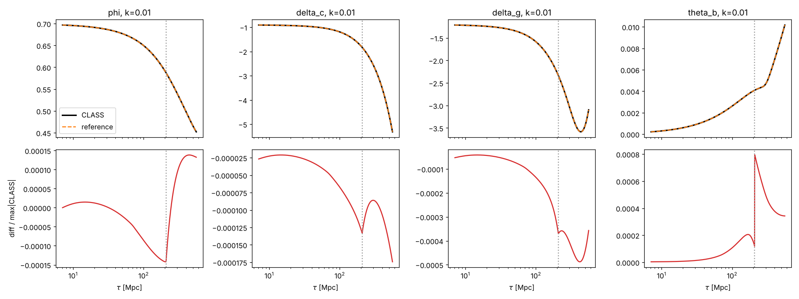
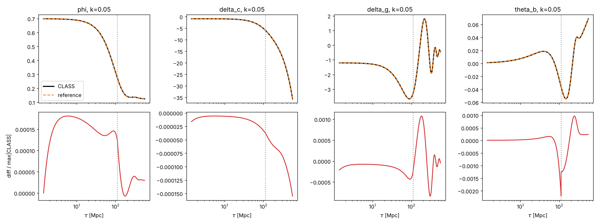

# Phase 0 results: infrastructure and reference solver

*2026-10-22. CLASS 3.4.1 (classy), JAX 0.12 (float64, CPU). Reproduce with `python -m pinn_cmb.validate_class --plots pinn_cmb/docs/figures` from the repo root.*

## Acceptance: PASS

The spec requires the reference solver to match CLASS to <1% on φ, δ_c and δ_γ at k = 0.01 and 0.05 Mpc⁻¹ through recombination. The comparison window runs from CLASS's first output (τ ≈ 1–7 Mpc) to 2τ_rec = 561 Mpc. The error is max_τ|X_ref − X_CLASS| / max_τ|X_CLASS|.

| k [Mpc⁻¹] | φ | ψ | δ_c | θ_c | δ_b | θ_b | δ_γ | θ_γ | σ_γ | δ_ν | θ_ν | σ_ν | max\|C₀₀\| |
|---|---|---|---|---|---|---|---|---|---|---|---|---|---|
| 0.01 | **1.4e-4** | 8.3e-4 | **1.7e-4** | 3.0e-4 | 3.7e-4 | 7.9e-4 | **4.9e-4** | 1.9e-3 | 1.7e-2 | 3.3e-4 | 7.8e-4 | 6.3e-4 | 1.9e-6 |
| 0.05 | **1.8e-4** | 3.0e-4 | **1.6e-4** | 1.7e-4 | 3.5e-4 | 2.2e-3 | **1.1e-3** | 1.6e-3 | 9.5e-3 | 2.6e-4 | 4.0e-4 | 3.5e-4 | 6.9e-7 |

C₀₀ is the 00-constraint residual, normalised by the magnitude of its terms (`equations.constraint_00`).

Settings (`configs/phase0.yaml`): Planck 2018 ΛCDM with massless ν (N_ur = 3.046) and no reionisation. ℓ_max = 17 for photons, polarisation and ν in both codes. CLASS runs with its radiation-streaming and ur-fluid approximations off and `tol_perturbations_integration = 1e-8`. Our reference uses Radau with rtol 1e-10 and zeroth-order TCA, switching at CLASS's default triggers (τ_c/τ_H = 0.015, τ_c/τ_k = 0.01).

## Where the residual differences come from

| Reference variant | k | φ | δ_c | δ_γ | θ_b | θ_γ | σ_γ |
|---|---|---|---|---|---|---|---|
| TCA, CLASS triggers (default) | 0.01 | 1.4e-4 | 1.7e-4 | 4.9e-4 | 7.9e-4 | 1.9e-3 | 1.7e-2 |
| | 0.05 | 1.8e-4 | 1.6e-4 | 1.1e-3 | 2.2e-3 | 1.6e-3 | 9.5e-3 |
| TCA, triggers ÷ 10 | 0.01 | 6.4e-5 | 6.2e-5 | 1.1e-4 | 8.1e-5 | 1.4e-4 | 9.3e-4 |
| | 0.05 | 1.8e-4 | 2.3e-4 | 2.7e-4 | 2.4e-4 | 2.8e-4 | 5.1e-4 |
| No TCA (stiff system from τ_i) | 0.01 | 3.4e-5 | 4.0e-5 | 4.2e-5 | 3.4e-5 | 4.6e-5 | 7.1e-5 |
| | 0.05 | 1.9e-4 | 1.9e-4 | 2.1e-4 | 1.9e-4 | 1.9e-4 | 1.9e-4 |

- **Zeroth-order TCA dominates the residual.** It sets θ_b = θ_γ and σ_γ = 0 exactly, whereas CLASS carries the first-order slip and shear. The visible effect is a transient at the switch: the θ_b spike in the k = 0.05 plot, and σ_γ, which is tiny before the switch, so even a small absolute difference is large relative to it. Our TCA-only solution converges to the full system in proportion to the trigger thresholds (error 2.7e-3 → 3.5e-4 → 4e-5 at triggers ×1, ÷10, ÷100), as expected for an O(τ_c) truncation.
- **Without TCA, the agreement with CLASS is ~2e-4 on every variable.** That floor is consistent with CLASS's own integration tolerance and with its first-order TCA, which still runs on the CLASS side. Hierarchy truncation is not a visible contributor: ℓ_max is matched and both codes use the M&B truncation.
- **ψ is ~5× worse than φ at k = 0.01.** ψ = φ − 6(a²/k²)ρσ is a small difference of larger terms at low k, so it inherits the shear's relative error.

## Finding: leading-order ICs are not good enough

With M&B's leading-order ICs (eq. 98 on arXiv v1), the first run disagreed with CLASS by 2–6% on every variable, and the 00-constraint residual grew linearly in τ to 5e-2.

Diagnosis:
1. On a state that satisfies the 00 constraint, the evolution equations give dC₀₀/dτ ≈ 1e-9 relative. So the equations themselves propagate the constraint correctly (`test_evolution_preserves_00_constraint`).
2. But evolving φ with the 0i equation leaves one constraint-violating solution, with C₀₀ ∝ 1/a. It grows like τ relative to the physical terms during radiation domination.
3. The leading-order ICs violate the constraint at O(τ_i/τ_eq) ≈ 1e-5. That seeded the mode, which grew by about 10⁴ by recombination.

Fix: use CLASS's adiabatic ICs, ported in `initial_conditions.adiabatic`. These are the synchronous-gauge expansion to first order in (kτ)² and ωτ, then the gauge transformation with α taken from the 00 and 0i equations. The initial C₀₀ is now < 1e-8 and stays ≤ 2e-6 through 2τ_rec. These ICs reduce to M&B eq. 98 to 2e-3 at τ_i (`test_ic_reduces_to_ma_bertschinger_eq98`).

**Consequence for the PINN:** its hard-IC wrapper must use the same constraint-consistent ICs. The 00 residual should stay in the loss as a diagnostic (spec §5), since a PINN can find this constraint-violating solution just as an ODE solver can.

## Finding: zeroth-order TCA is not valid up to τ = 200 at high k

At k = 0.05 the CLASS trigger τ_c/τ_k = 0.01 fires at τ ≈ 112 Mpc. Running zeroth-order TCA up to τ = 200, as the original Phase 1 spec says, would put O(1e-2) physical errors in θ_γ. The spec now caps the Phase 1 domain at τ_switch(k) (spec Rev 2, item 7).

## Performance

The reference takes 4–8 s per k-mode on one CPU core, with rtol 1e-10 and ~10⁴ RHS evaluations. The RHS and its exact Jacobian are JAX-compiled and called from scipy. That is fast enough to generate PINN test sets of hundreds of modes.

## Tests

Run `pytest` from `pinn_cmb/`: 34 tests, ~90 s (the CLASS-dependent ones are marked `slow`).

| Test | What it pins down |
|---|---|
| `test_truncation_is_exact_for_bessel_functions` | M&B truncation eq. (51)/(65): exact for F_l = j_l(kτ) |
| `test_neutrino_free_streaming_gives_bessel_functions` | ν hierarchy eq. (50): F_l(τ) = j_l(kτ) to 1e-7 |
| `test_photon_free_streaming_without_scattering` | photon streaming terms of eq. (64); G stays 0 without scattering |
| `test_thomson_scattering_conserves_momentum` | Thomson coupling in the θ_γ and θ_b equations, including the 1/R factor |
| `test_tight_coupling_balance_of_polarisation` | Thomson terms of the G_0 and G_2 equations; consistency of `tca_to_full` |
| `test_tca_momentum_equation_is_weighted_euler` | TCA θ̇_γb equation vs the full Euler equations |
| `test_ic_reduces_to_ma_bertschinger_eq98` | IC coefficients, including R_ν in φ/ψ (ij equation) |
| `test_ic_satisfies_00_constraint` | Einstein 00 at τ_i, for both layouts and three k |
| `test_ic_is_radiation_era_growing_mode` | each Euler, continuity, 0i and shear equation on the growing mode |
| `test_evolution_preserves_00_constraint` | all equations jointly (Bianchi identity), both layouts |
| `test_background.py` (6 tests) | ℋ, κ̇ and c_b² vs CLASS; ℋ = d ln a/dτ; early extrapolation; r_s(τ_rec) |
| `test_reference.py` (6 tests) | constraint preservation, TCA → full convergence, rtol convergence, Phase 0 acceptance |
