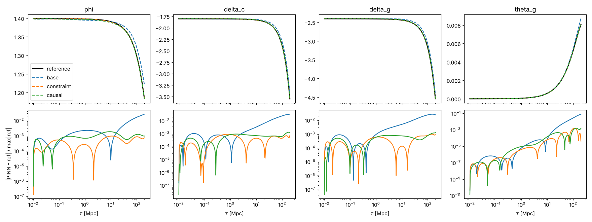

# Pilot 1: single-k PINN for the tight-coupled system

*2026-10-22. Script: `pilots/pilot_single_k.py`. CPU only (1 core used), float64.*

## Question

Can a data-free PINN solve the coupled tight-coupled Einstein–Boltzmann system to the Phase 1 accuracy target (1e-3)? Does the constraint drift found in Phase 0 hurt it?

## Setup

- **Problem:** one mode, k = 0.01 Mpc⁻¹. Zeroth-order TCA layout: φ, δ_c, θ_c, δ_b, δ_γ, θ_γb, δ_ν, θ_ν and F_ν2–F_ν4 (11 outputs, ℓ_max,ν = 4). Time runs from τ_i = 0.01 Mpc to 200 Mpc, about 10 e-folds; the TCA trigger for this k fires at 208 Mpc.
- **Network:** an MLP with 4 hidden layers of 64 tanh units, taking x = ln(τ/τ_i)/ln(τ_max/τ_i) ∈ [0,1].
- **Hard ICs:** u = u_IC + (1 − e^{−x/0.1})·S(τ)·N(x), with the constraint-consistent ICs from Phase 0.
- **Loss:** the ODE residual from `equations.rhs` in log time, per variable, divided by S(τ). Optionally plus w·C₀₀², the normalised 00-constraint residual. 2048 stratified collocation points, resampled every step.
- **Optimiser:** Adam for 20k steps (lr 1e-3, cosine decay), then L-BFGS (optax) on a fixed set of 4096 points.
- **Error:** max_τ|PINN − ref| / max_τ|ref| against the `tca_only` reference (Radau, rtol 1e-10) on 400 points. The reference is never used in training.

## Results

| Variant | L-BFGS steps | φ | ψ | δ_c | θ_c | δ_b | δ_γ | θ_γ | δ_ν | θ_ν | σ_ν | max\|C₀₀\| | time |
|---|---|---|---|---|---|---|---|---|---|---|---|---|---|
| residual only | 3k | 2.7e-2 | 2.7e-2 | 3.3e-2 | 2.1e-2 | 2.7e-2 | 2.8e-2 | 8.1e-2 | 2.8e-2 | 1.3e-1 | 7.2e-2 | 3.6e-2 | 4.8 min |
| + constraint loss (w=1) | 3k | 9.7e-4 | 1.2e-3 | 9.2e-4 | 8.9e-4 | 9.8e-4 | 1.0e-3 | 1.6e-3 | 7.5e-4 | 2.5e-3 | 3.8e-3 | 5.7e-4 | 4.8 min |
| + constraint + causal (ε=1) | 3k | 1.9e-3 | 1.7e-3 | 1.3e-3 | 1.3e-3 | 1.1e-3 | 1.3e-3 | 1.6e-3 | 1.4e-3 | 1.9e-3 | 1.7e-3 | 3.3e-4 | 5.1 min |
| **+ constraint loss, longer polish** | **12k** | **8.5e-5** | **3.2e-4** | **1.8e-4** | **6.7e-5** | **1.1e-4** | **1.5e-4** | **2.0e-4** | **1.5e-4** | **1.3e-4** | **6.2e-4** | **1.1e-4** | **9.0 min** |

The bold row meets the Phase 1 target (< 1e-3) on every variable. The final loss was still falling (2.3e-7 after 12k L-BFGS steps).

*The plot shows the 3k-step runs. Without the constraint term (blue), the error grows steadily after τ ~ 10 Mpc: that is the constraint-violating mode.*

## Findings

1. **The constraint loss is essential, not just a diagnostic.** The residual-only run reached a lower ODE loss (3.8e-6) than the constrained one, yet was 30× less accurate. Small residual errors feed the constraint-violating solution of the 0i formulation, which grows like τ (Phase 0 finding). The 00 residual is the only term that penalises it. The spec should make it a mandatory loss term.
2. **Physical output scaling is required.** With fixed per-variable scales, the initial loss was 3e11 and training failed. The 0i equation computes φ̇ from θ with a 1/(kτ)² amplification outside the horizon. Scaling each output by its super-horizon growth fixes this: θ ∝ k²τ, F_νℓ ∝ (kτ)^ℓ, rolling over to O(1) at kτ ~ 1. The initial loss then becomes O(1).
3. **L-BFGS does most of the work.** Adam alone reached ~2e-4 loss. L-BFGS gave another 3 orders of magnitude and was still improving. Natural-gradient or longer second-order polishing is the obvious lever for more accuracy.
4. **Causal weighting made no difference at ε = 1.** The weights stayed ≈ 1, so ε was too small to matter at this loss scale. It isn't needed for this smooth, single-mode problem, and should be retested with a schedule on harder problems (high k, recombination).

## What this does and does not show

- **Shows:** a data-free PINN can solve the coupled, constraint-sensitive tight-coupled system at one k to ~1e-4 (worst variable 6e-4), in minutes on a CPU.
- **Does not show yet:**
  - generalisation across k (Phase 1 needs a k-bundle tested on 20 held-out k);
  - high k, where δ_γ oscillates (at k = 0.05 there are ~2 oscillations before the TCA switch, at k = 0.2 many);
  - recombination and the full photon hierarchy (Phase 3);
  - robustness to the random seed (one seed per variant here).
