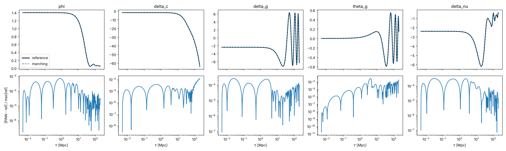

# Pilot 2: oscillating modes (k = 0.05, k = 0.2)

*2026-10-23. Scripts: `pilots/pilot_single_k.py`, `pilots/pilot_marching.py`. CPU, float64. All runs use the pilot 1 recipe: hard constraint-consistent ICs, time-dependent output scaling, ODE residual + 00-constraint loss (w = 1), Adam then L-BFGS. The reference (`tca_only`, ℓ_max,ν = 4) is used only for evaluation.*

## Question

Pilot 1 worked at k = 0.01, where nothing oscillates. Does the method survive acoustic oscillations, and does the cos/sin(k r_s) × damping ansatz help?

**The tight-coupling (TCA) regime holds few oscillations at any k.** The trigger k/κ̇ < 0.01 makes higher-k modes leave tight coupling earlier. Every mode therefore completes at most ~1–2 acoustic oscillations inside the TCA domain (k = 0.05: 0.5 oscillations before τ_switch = 112 Mpc). So two cases were run:
- **(a) k = 0.05 up to its TCA switch.** This is the physical Phase 1 case.
- **(b) k = 0.2 with TCA forced up to τ = 200 Mpc**, giving 3.4 acoustic oscillations. This is not physically valid, but it is a stress test of oscillation handling that Phase 3 will need.

## Results (max-normalised error)

| Case | Method | φ | ψ | δ_c | δ_b | δ_γ | θ_γ | δ_ν | θ_ν | σ_ν | max\|C₀₀\| | CPU time |
|---|---|---|---|---|---|---|---|---|---|---|---|---|
| (a) k=0.05 | one network | 1.0e-3 | 1.6e-3 | 1.1e-3 | 1.1e-3 | 9.8e-4 | 1.3e-3 | 1.3e-3 | 1.8e-3 | 1.3e-3 | 2.4e-4 | 15 min |
| (a) k=0.05 | one network + osc ansatz | 7.9e-4 | 1.4e-3 | 5.2e-4 | 5.1e-4 | 4.9e-4 | 1.0e-3 | 6.2e-4 | 8.5e-4 | 6.8e-4 | 6.7e-4 | 18 min |
| (a) k=0.05 | time-marching, 2 windows + ansatz | 1.2e-3 | 1.6e-3 | 2.0e-4 | 5.7e-4 | 3.8e-4 | 5.1e-4 | 4.6e-4 | 5.1e-4 | 2.7e-4 | 7.3e-4 | 11 min |
| (b) k=0.2 | one network | 9.3e-1 | 9.6e-1 | 9.9e-1 | 9.5e-1 | 1.0 | 1.0 | 1.0 | 1.0 | 1.0 | 2.1e-2 | 16 min |
| (b) k=0.2 | one network + osc ansatz | 8.7e-1 | 9.0e-1 | 9.6e-1 | 9.0e-1 | 9.5e-1 | 9.4e-1 | 9.6e-1 | 9.5e-1 | 9.6e-1 | 7.5e-2 | 18 min |
| (b) k=0.2 | + ansatz + causal ε=10 | 8.2e-1 | 8.6e-1 | 9.5e-1 | 8.7e-1 | 8.9e-1 | 8.9e-1 | 9.0e-1 | 9.0e-1 | 9.0e-1 | 1.3e-2 | 19 min |
| (b) k=0.2 | + ansatz + causal ε=100 | 9.5e-1 | 9.6e-1 | 9.9e-1 | 9.4e-1 | 9.9e-1 | 9.9e-1 | 1.0 | 1.0 | 1.0 | 1.7e-2 | 18 min |
| **(b) k=0.2** | **time-marching, 8 windows + ansatz** | **7.2e-4** | **1.0e-3** | **1.2e-4** | **2.8e-4** | **2.7e-4** | **2.8e-4** | **3.2e-4** | **4.5e-4** | **1.9e-4** | **7.2e-4** | **35 min** |

Time-marching windows: τ_i → (kτ = 1), then one per Δ(kτ) = 2π. At k = 0.2 that gives 8 windows, each a 4×64 MLP trained with 5k Adam + 4k L-BFGS steps. CPU times are per run, with two runs sharing 4 cores.

## Findings

1. **A single global network fails on multi-oscillation modes by falling into a trivial solution.** At k = 0.2 it relaxed every variable towards zero from τ_i onwards, stalling at loss ~3e-3 with O(1) error. This is not an equations or scaling problem: the super-horizon segment alone (τ ≤ 1 Mpc) trains to ~2e-3 at k = 0.2. Over the full 10.6 e-folds, the optimiser gives up accuracy at early times to reduce the larger late-time oscillatory residual, and early errors then propagate through the constraint-violating mode.
2. **Causal weighting (Wang et al. 2022) did not fix it** at either ε = 10 or ε = 100. ε = 100 froze the later bins (weights → 0) without driving the early bins to an accurate solution.
3. **Time-marching fixes it.** With one small network per oscillation period, chained by hard ICs, errors stay at ~1e-4–1e-3 across all 8 windows with no visible accumulation. Every variable meets the 1e-3 target.
4. **The oscillation ansatz helps modestly** (≈2× at k = 0.05) but cannot fix a failure in the global optimisation. Its real value should show in Phase 3, where windows hold many oscillations.
5. **Cost is the open issue.** Marching costs ~4–6 CPU-min per window, so 35 min for one k-mode, against ~5 s for the Radau reference. That is fine for a pilot, but the bundle (many k, then cosmological parameters) must amortise it.

## Implications for the spec

- **Time-marching becomes the default architecture**, not just the fix at the recombination boundary. Window edges follow the physics: the super-horizon window, then about one oscillation period per window. For a k-bundle, use windows in a k-independent variable such as kτ or k r_s, or k-dependent windows over log k slices.
- Causal weighting is demoted to optional.
- The oscillation ansatz stays, in its damped form.
- For Phase 1 (TCA only, ≤ 2 oscillations), one to three windows suffice.

## Caveats

One seed per configuration. Single k per run (no bundle yet). TCA equations only, so recombination and the full photon hierarchy remain untested. The k = 0.2 case is a numerical stress test, not physics.
